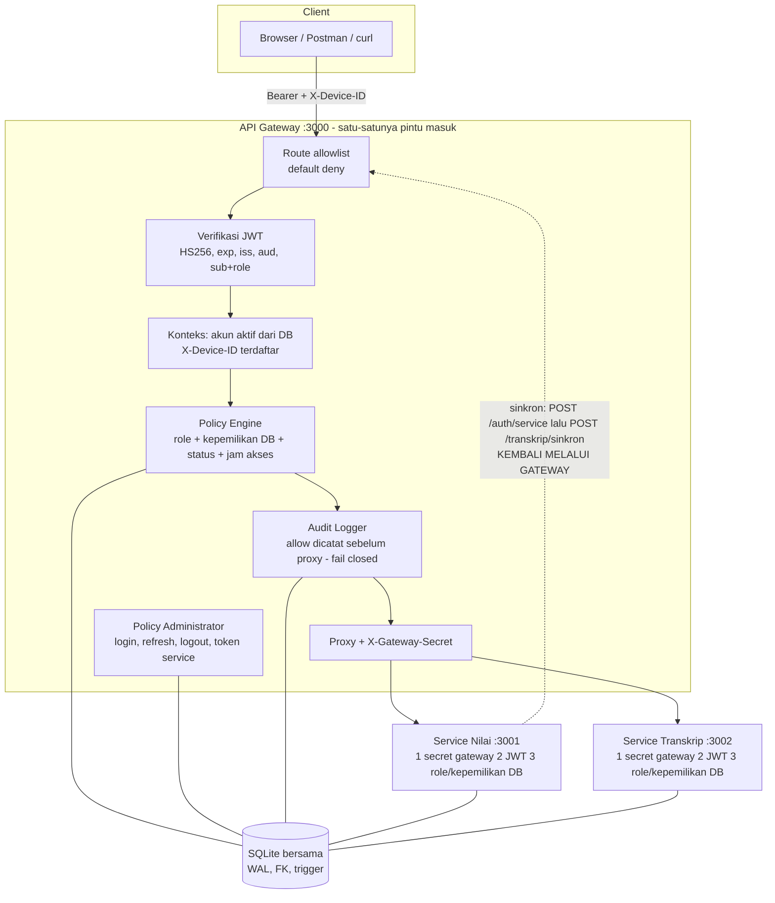
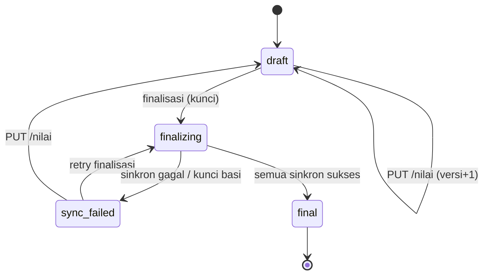
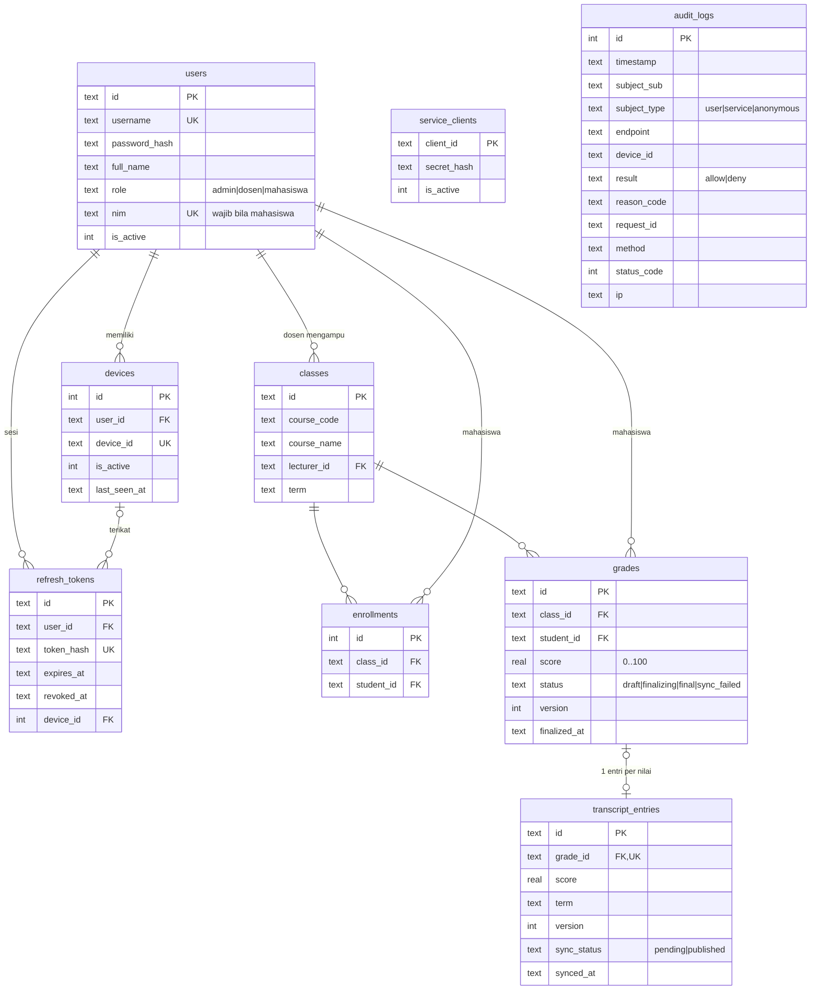

# Arsitektur SecureCampus

Seluruh diagram memakai Mermaid (dirender otomatis oleh GitHub/VS Code/Mermaid Live Editor). File gambar hasil render **tidak** dibuat karena lingkungan pembuatan tidak memiliki browser untuk mermaid-cli — lihat TEST_REPORT bagian "Tidak dijalankan".

## 1. Komponen dan batas kepercayaan



Prinsip Zero Trust → mekanisme:

| Prinsip | Mekanisme yang diimplementasikan |
|---|---|
| Never trust, always verify | Gateway memeriksa tiap request (token+device+policy). Service memeriksa ulang secret, signature, expiry, role, dan kepemilikan — tidak mempercayai header identitas apa pun dari gateway/client |
| Least privilege | Policy per endpoint × role × objek (DB). Admin hanya baca transkrip; token service hanya `POST /transkrip/sinkron`; token user ditolak di endpoint sinkron |
| Assume breach | Secret gateway saja tidak cukup (JWT tetap wajib); token berumur pendek; refresh dapat dicabut & dirotasi; service bukan jalur bypass; audit semua keputusan; route tak dikenal ditolak |
| Context-aware | Device terdaftar & terikat user, jam akses 07:00–21:00 `Asia/Jakarta`, status nilai (final/finalizing), kepemilikan kelas/NIM dari database |

## 2. Urutan login dan request bisnis

```mermaid
sequenceDiagram
  autonumber
  participant C as Client
  participant G as Gateway :3000
  participant DB as Database
  participant S as Service Nilai/Transkrip
  C->>G: POST /auth/login (username, password, X-Device-ID)
  G->>DB: user + hash bcrypt; device milik user?
  G->>DB: simpan HASH refresh token; audit LOGIN_SUCCESS
  G-->>C: access JWT 600 dtk + refresh token 86400 dtk
  C->>G: GET /nilai (Bearer, X-Device-ID)
  G->>G: verifikasi JWT (signature, exp, iss, aud)
  G->>DB: akun aktif & role sama dgn klaim; device terikat ke sub
  G->>DB: Policy Engine membaca kepemilikan/status
  alt DENY
    G->>DB: audit deny + reason_code
    G-->>C: 401/403/404/409 (JSON seragam)
  else ALLOW
    G->>DB: audit allow (gagal tulis => 500, TIDAK diteruskan)
    G->>S: request + X-Gateway-Secret (ditambah server)
    S->>S: cek secret, verifikasi JWT ulang, role, kepemilikan DB
    S-->>G: data
    G-->>C: 200
  end
```

## 3. Finalisasi kelas dan sinkronisasi transkrip

```mermaid
sequenceDiagram
  autonumber
  participant D as Dosen
  participant G as Gateway :3000
  participant N as Service Nilai :3001
  participant T as Service Transkrip :3002
  participant DB as Database
  D->>G: POST /kelas/CLS-501/finalisasi
  G->>DB: pemilik kelas? jam akses? nilai lengkap? masih ada non-final?
  G->>N: forward + X-Gateway-Secret
  N->>DB: (txn A) draft/sync_failed -> finalizing
  N->>G: POST /auth/service (client id + secret dari env)
  G-->>N: token service 300 dtk, role=service
  loop tiap nilai
    N->>G: POST /transkrip/sinkron (Bearer token service, Idempotency-Key)
    G->>G: policy: hanya token service; audit allow (subject service)
    G->>T: forward + X-Gateway-Secret
    T->>DB: verifikasi payload vs grades; upsert entri PENDING (idempoten)
    T-->>G: 201/200
    G-->>N: ok
  end
  alt semua sukses
    N->>DB: (txn C) grades=final + transcript_entries=published (atomik lokal)
    N-->>D: 200 transcript_sync=success
  else ada yang gagal / service mati
    N->>DB: finalizing -> sync_failed (pending tetap tersembunyi)
    N-->>D: 502 UPSTREAM_SERVICE_FAILURE (retryable)
  end
```

Konsistensi: **tidak ada transaksi atomik lintas HTTP**. Yang diimplementasikan: transaksi lokal A dan C (SQLite `IMMEDIATE`), upsert idempoten `(grade_id, version)` dengan `UNIQUE(grade_id)`, status `finalizing/sync_failed`, kunci basi dilepas setelah `FINALIZE_LOCK_TIMEOUT_MS`, dan entri `pending` tidak pernah tampil di transkrip. Retry = memanggil endpoint finalisasi lagi.

## 4. Status nilai


`final` immutable lewat endpoint normal. Selama `finalizing`, edit ditolak (409).

## 5. ERD


Integritas di level DB: FK aktif; `UNIQUE(class_id, student_id)` pada enrollments dan grades; `CHECK` skor 0–100, status, role; trigger (dosen harus role dosen, peserta harus mahasiswa, nilai hanya untuk mahasiswa terdaftar); `grades.status='final' ⇔ finalized_at IS NOT NULL`; `transcript_entries.sync_status='published' ⇔ synced_at IS NOT NULL`; `audit_logs` append-only (trigger menolak DELETE dan UPDATE selain pengisian `status_code`). Indeks sesuai PRD 10.5.

## 6. Pemisahan modul (kode)

| Modul | Tanggung jawab |
|---|---|
| `apps/gateway/src/policy/route-table.js` | Allowlist route (default deny), pencocokan segmen dengan karakter aman |
| `apps/gateway/src/policy/policy.js` + `policy-data.js` | Policy Engine: keputusan terstruktur `{decision, reasonCode}`; atribut dibaca dari DB |
| `apps/gateway/src/services/auth.service.js` | Policy Administrator: login, refresh (rotasi atomik), logout, token service |
| `apps/gateway/src/middleware/audit.js` | Audit logger (strict untuk allow, best-effort untuk deny) |
| `apps/gateway/src/proxy/service-proxy.js` | Proxy, menimpa `X-Gateway-Secret`, mencatat kegagalan hulu |
| `packages/security/` | JWT, password, perbandingan waktu-konstan, middleware verifikasi service |
| `packages/shared/` | Config, error standar, validator, jam akses/clock, logger tersanitasi |
| `packages/database/` | Skema+migrasi, seed idempoten, CLI |
